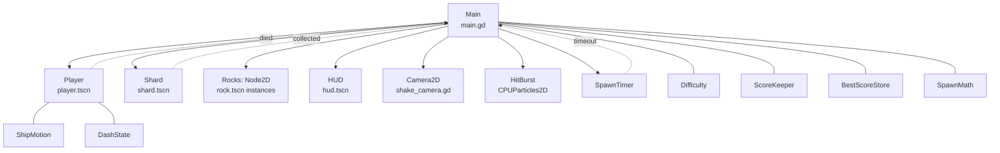

# Shard Drift architecture

This is the build reference for Shard Drift, the one-screen dodger described in the game design document, [GDD.md](GDD.md). It lists every file, the job of each one, every tuning number, and how the parts talk to each other. A single Claude Code conversation builds the game from this document.

The GDD says what the game is. This file says how to build it, and wins wherever the two differ. The user accepted this file and the decision records in [adr/](adr/) on 2026-10-18, so they are the source of truth. From then on, any change to the layout or rules below needs a new or updated decision record.

Written 2026-10-17 against Godot 4.7.2 (`godot --version` prints `4.7.2.stable.arch_linux`).

## The short version

- Godot 4.7, typed GDScript, scene files written by hand. No editor work and no add-ons ([ADR 0001](adr/0001-godot-gdscript-handwritten-scenes.md)).
- Game rules and tuning numbers live in small plain-script classes under `src/logic/` that know nothing about nodes. Unit tests cover them, and scenes call them ([ADR 0002](adr/0002-pure-logic-classes.md)).
- Tests run headless with a small runner in `tests/`, wrapped by `tests/check.sh`, so there's nothing to download ([ADR 0003](adr/0003-headless-test-runner.md)).
- `main.gd` is the only script that coordinates. Children report events with signals and `main.gd` calls methods on them. There are no autoloads or global event buses ([ADR 0004](adr/0004-signals-up-calls-down.md)).
- All art is drawn with `Polygon2D` and `CPUParticles2D`. Sprites can replace it later without changing any script ([ADR 0005](adr/0005-procedural-placeholder-art.md)).

## How the parts connect

The diagram shows the running scene tree. Solid arrows are method calls from `main.gd` down to its children. Dashed arrows are signals going back up. The boxes at the bottom are the logic classes that `main.gd` and the player own.



## Files

```text
shard-drift/
├── project.godot
├── icon.svg                     # Godot's default icon
├── docs/                        # GDD, this file, ADRs
├── scenes/
│   ├── main.tscn
│   ├── player.tscn
│   ├── rock.tscn
│   ├── shard.tscn
│   └── hud.tscn
├── src/
│   ├── logic/                   # no Node code; unit tested
│   │   ├── difficulty.gd
│   │   ├── score_keeper.gd
│   │   ├── best_score_store.gd
│   │   ├── spawn_math.gd
│   │   ├── ship_motion.gd
│   │   └── dash_state.gd
│   ├── main.gd
│   ├── player.gd
│   ├── rock.gd
│   ├── shard.gd
│   ├── hud.gd
│   └── fx/shake_camera.gd
└── tests/
    ├── check.sh                 # runs every headless check; the one command to trust
    ├── run_tests.gd             # extends SceneTree; finds and runs test_*.gd
    ├── test_difficulty.gd
    ├── test_score_keeper.gd
    ├── test_best_score_store.gd
    ├── test_spawn_math.gd
    ├── test_ship_motion.gd
    ├── test_dash_state.gd
    └── test_scenes.gd           # every .tscn loads and instantiates
```

## Logic classes

Each one `extends RefCounted` and has a `class_name`. None of them touch nodes, the scene tree or input. Anything random takes a `rng: RandomNumberGenerator` argument so tests can pass a seeded one and get the same result every run.

Tuning numbers are `const` lines at the top of each class, with the values below. Tests read the constants instead of repeating the numbers. Scene scripts don't use `@export` for tuning.

### Difficulty

| Member | Behavior |
|---|---|
| `const STEP_SECONDS := 15.0`, `BASE_INTERVAL := 1.2`, `INTERVAL_STEP := 0.1`, `MIN_INTERVAL := 0.4`, `BASE_ROCK_SPEED := 180.0`, `SPEED_GROWTH := 1.1` | |
| `var elapsed: float`, `var level: int` | Both start at 0. |
| `advance(delta: float) -> bool` | Adds `delta` to `elapsed`, sets `level = int(elapsed / STEP_SECONDS)`, and returns `true` if `level` changed. A huge `delta` that crosses two steps still returns `true` once, with `level` correct. |
| `spawn_interval() -> float` | `maxf(MIN_INTERVAL, BASE_INTERVAL - INTERVAL_STEP * level)` |
| `rock_speed() -> float` | `BASE_ROCK_SPEED * pow(SPEED_GROWTH, level)` in pixels per second. Use `pow`; `^` is bitwise XOR in GDScript. |

A speed change applies to rocks spawned afterwards. Rocks already flying keep their speed.

### ScoreKeeper

| Member | Behavior |
|---|---|
| `const SHARD_POINTS := 10` | |
| `_init(starting_best: int)` | `score = 0`, `best = starting_best`. |
| `add_shard()` | Adds `SHARD_POINTS`. If `score > best`, sets `best = score`. |
| `is_new_best() -> bool` | `true` only if `score` is strictly greater than `starting_best`. A tie isn't a new best. |

### BestScoreStore

| Member | Behavior |
|---|---|
| `const PATH := "user://best.txt"` | |
| `static func load_best(path: String) -> int` | Missing, empty or non-numeric file returns 0. |
| `static func save_best(path: String, value: int) -> void` | Writes the number as text. |

Game code passes `BestScoreStore.PATH`. Tests pass `user://test_best.txt` and delete it afterwards with `DirAccess.remove_absolute`.

### SpawnMath

All static.

| Member | Behavior |
|---|---|
| `const EDGE_MARGIN := 60.0`, `AIM_SPREAD := 0.35`, `ROCK_RADIUS_MIN := 18.0`, `ROCK_RADIUS_MAX := 42.0`, `ROCK_SPIN_MAX := 2.0`, `SHARD_INSET := 60.0`, `SHARD_MIN_DIST := 200.0` | `AIM_SPREAD` and `ROCK_SPIN_MAX` are in radians and radians per second. |
| `edge_point(rect: Rect2, rng: RandomNumberGenerator) -> Vector2` | A point `EDGE_MARGIN` pixels outside a random edge of `rect`, at a random position along it. |
| `aim(from: Vector2, target: Vector2, rng: RandomNumberGenerator) -> Vector2` | Unit vector from `from` toward `target`, rotated by a random angle in `±AIM_SPREAD`. |
| `rock_radius(rng: RandomNumberGenerator) -> float` | Uniform between the two radius constants. |
| `rock_spin(rng: RandomNumberGenerator) -> float` | Uniform in `±ROCK_SPIN_MAX`. |
| `rock_polygon(radius: float, rng: RandomNumberGenerator) -> PackedVector2Array` | 7 to 9 points evenly spaced by angle, each at 70–100% of `radius`. |
| `shard_point(rect: Rect2, avoid: Vector2, rng: RandomNumberGenerator) -> Vector2` | A random point inside `rect` shrunk by `SHARD_INSET` on every side, at least `SHARD_MIN_DIST` from `avoid`. Tries up to 20 times, then returns the last try. |

`rect` is the play field, `Rect2(0, 0, 1280, 720)`. `main.gd` passes the viewport rect.

### ShipMotion

All static.

| Member | Behavior |
|---|---|
| `const MAX_SPEED := 420.0`, `ACCELERATION := 2400.0`, `FRICTION := 1800.0`, `DASH_SPEED := 900.0`, `SCREEN_PADDING := 16.0` | Pixels per second, or pixels per second squared. |
| `step(velocity: Vector2, input_dir: Vector2, delta: float) -> Vector2` | With input, moves `velocity` toward `input_dir.normalized() * MAX_SPEED` by `ACCELERATION * delta`. With no input, moves it toward zero by `FRICTION * delta`. Use `Vector2.move_toward`. |
| `dash_velocity(velocity: Vector2, input_dir: Vector2, facing: Vector2) -> Vector2` | `DASH_SPEED` in the input direction, or along `facing` if there's no input. |
| `clamp_to(rect: Rect2, pos: Vector2) -> Vector2` | Keeps `pos` at least `SCREEN_PADDING` inside `rect`. |

While a dash is active, the player skips `step` and keeps the dash velocity. When the dash ends, `step` brings the speed back down to `MAX_SPEED` through normal acceleration.

### DashState

| Member | Behavior |
|---|---|
| `const DASH_TIME := 0.15`, `INVULNERABLE_TIME := 0.3`, `COOLDOWN := 2.0` | |
| `try_dash() -> bool` | Fails while the cooldown is running. On success, starts all three timers at once. The cooldown counts from the moment of the press, so the next dash is possible 2.0 s after the last one started. |
| `tick(delta: float) -> void` | Counts the timers down. |
| `is_dashing() -> bool`, `is_invulnerable() -> bool` | `true` while each timer is above zero. |
| `cooldown_ratio() -> float` | 0.0 right after a dash, rising to 1.0 when ready. Ready at start. |

## Scenes and their contracts

Visual and collision sizes, in pixels:

| Object | Visual (`Polygon2D`) | Collision |
|---|---|---|
| Ship | triangle `(16, 0), (-12, -10), (-12, 10)`, cyan `#4fd1ff` | body `CircleShape2D` radius 10; `Hurtbox` `CircleShape2D` radius 8 |
| Rock | `SpawnMath.rock_polygon(radius)`, grey `#8a8f98` | `CircleShape2D` radius `0.85 * radius` |
| Shard | diamond `(0, -12), (9, 0), (0, 12), (-9, 0)`, yellow `#ffd84a` | `CircleShape2D` radius 14 |

### player.tscn

Root `Player: CharacterBody2D` with `Visual: Polygon2D`, `CollisionShape2D`, and `Hurtbox: Area2D` containing its own `CollisionShape2D`.

- Signal: `died`.
- Methods `main.gd` calls: `dash_ratio() -> float` (returns `DashState.cooldown_ratio()`) and `freeze() -> void`.
- `_physics_process`: read input with `Input.get_vector("move_left", "move_right", "move_up", "move_down")`; on `Input.is_action_just_pressed("dash")` call `try_dash()` and, if it succeeds, set velocity from `ShipMotion.dash_velocity`; otherwise call `ShipMotion.step` unless dashing. Then `move_and_slide()`, clamp the position, rotate to face the velocity when moving, and `tick` the dash state.
- Hit check: once per physics frame, if `not _dead`, `not dash.is_invulnerable()` and `$Hurtbox.has_overlapping_areas()`, set `_dead = true` and emit `died`. Polling the overlap instead of using `area_entered` means a rock still touching the ship when invulnerability runs out still counts. The `_dead` flag stops `died` firing twice.
- `freeze()`: sets `_dead = true`, hides the ship, stops `_physics_process` with `set_physics_process(false)`, and turns off the hurtbox with `$Hurtbox.set_deferred("monitoring", false)`.
- While dashing, draw the ship at 50% opacity so the player can see the invulnerable window.

### rock.tscn

Root `Rock: Area2D` with `Visual: Polygon2D`, `CollisionShape2D` (no shape resource in the file), and `VisibleOnScreenNotifier2D`.

- Method: `setup(pos: Vector2, velocity: Vector2, radius: float, spin: float, polygon: PackedVector2Array) -> void`. `main.gd` calls it before `add_child`, when `@onready` nodes are still `null`. So `setup` only stores the values in member variables and sets `position`. `_ready()` applies them to the nodes.
- `_ready()`: create a new `CircleShape2D` for this rock with `radius * 0.85` and assign it to the collision shape. Don't share one shape resource between rocks, or resizing one resizes all of them. Set the visual's polygon. Set the notifier's `rect` to `Rect2(-radius, -radius, radius * 2, radius * 2)`.
- `_process`: move by velocity, rotate by spin.
- Cleanup: on `screen_entered` set `_has_entered = true`; on `screen_exited`, if `_has_entered`, call `queue_free()`. A rock aimed with spread can miss the screen entirely and never enter, so every rock also frees itself after `const LIFETIME := 12.0` seconds.
- Collision: layer 2 (`rocks`), mask 0. Rocks don't detect anything.

### shard.tscn

Root `Shard: Area2D` with `Visual: Polygon2D`, `CollisionShape2D`, and `Sparkle: CPUParticles2D`.

- Signal: `collected`.
- Method: `move_to(pos: Vector2) -> void`.
- `body_entered` from the player emits `collected`.
- Collision: layer 3 (`shard`), mask 1 (`player`).
- Pulse: in `_ready`, a looping `Tween` scales `Visual` between 1.0 and 1.25 over 0.4 s each way.
- `Sparkle`: `amount = 8`, `lifetime = 0.6`, `emission_shape = EMISSION_SHAPE_SPHERE` with radius 10, `gravity = Vector2.ZERO`, `initial_velocity_min = 10`, `initial_velocity_max = 30`, yellow.

### hud.tscn

The HUD is the heads-up display drawn over the game. Root `HUD: CanvasLayer` with:

| Node | Type | Content |
|---|---|---|
| `ScoreLabel` | `Label`, top left at (16, 12) | `Score: 0` |
| `BestLabel` | `Label`, top right, right-aligned | `Best: 0` |
| `DashBar` | `ProgressBar`, under `ScoreLabel`, 160 × 10 | `min_value = 0.0`, `max_value = 1.0`, `step = 0.01`, `show_percentage = false` |
| `GameOverPanel` | `PanelContainer`, centered, hidden at start | contains `FinalLabel: Label` |

Methods: `set_score(n: int)`, `set_best(n: int)`, `set_dash_ratio(r: float)`, `show_game_over(score: int, best: int, new_best: bool)`. The final text is `Score: N`, `Best: N`, a `New best!` line when `new_best` is true, and `Press Space to play again`. The HUD emits nothing.

### main.tscn

Root `Main: Node2D` with `main.gd`, and these children in this order (later children draw on top):

| Node | Setup |
|---|---|
| `Background: ColorRect` | 1280 × 720 at (0, 0), color `#0b0e17` |
| `Stars: CPUParticles2D` | position (1280, 360), `amount = 80`, `lifetime = 40.0`, `preprocess = 40.0`, `emission_shape = EMISSION_SHAPE_RECTANGLE`, `emission_rect_extents = Vector2(4, 360)`, `direction = Vector2(-1, 0)`, `spread = 0`, `gravity = Vector2.ZERO`, `initial_velocity_min = 15`, `initial_velocity_max = 40`, `scale_amount_min = 1`, `scale_amount_max = 2.5`, white at 60% alpha |
| `Rocks: Node2D` | empty holder for rock instances |
| `Shard` | instance of `shard.tscn` |
| `Player` | instance of `player.tscn`, position (640, 360) |
| `HitBurst: CPUParticles2D` | `emitting = false`, `one_shot = true`, `amount = 40`, `lifetime = 0.6`, `explosiveness = 1.0`, `spread = 180`, `gravity = Vector2.ZERO`, `initial_velocity_min = 100`, `initial_velocity_max = 300`, cyan |
| `Camera2D` | `shake_camera.gd`, position (640, 360), `enabled = true` |
| `SpawnTimer: Timer` | `wait_time = 1.2`, `autostart = false` |
| `HUD` | instance of `hud.tscn` |

The camera must sit at the screen center. At the default (0, 0) it would center the view on the top-left corner and shift the whole play field.

`shake_camera.gd` (`extends Camera2D`) has one method, `shake(strength: float = 8.0, duration: float = 0.25) -> void`. Each frame while shaking it sets `offset` to a random vector up to `strength` pixels long, scaled down linearly to zero over `duration`, then resets `offset` to `Vector2.ZERO`.

### Collision layers

| Layer | Name | On it | Watched by |
|---|---|---|---|
| 1 | `player` | Player body | Shard (mask 1) |
| 2 | `rocks` | Rock areas | Player `Hurtbox` (mask 2) |
| 3 | `shard` | Shard area | nobody; the shard does the detecting |

The player body has mask 0, and the `Hurtbox` has layer 0 and mask 2. The ship never pushes against anything and is kept on screen by `ShipMotion.clamp_to`. Name the layers in `project.godot` under `[layer_names]` as `2d_physics/layer_1="player"` and so on. In `.tscn` files, layer and mask values are bitmasks: layer 1 is `1`, layer 2 is `2`, layer 3 is `4`.

## Game flow in `main.gd`

`main.gd` has two states, `PLAYING` and `GAME_OVER`, held in an `enum`, and one constant of its own, `const RESTART_DELAY := 0.5`.

1. `_ready()`: read the best score with `BestScoreStore.load_best(BestScoreStore.PATH)`. Create `ScoreKeeper`, `Difficulty` and a `RandomNumberGenerator`, and call `randomize()` on it. Connect `player.died`, `shard.collected` and `$SpawnTimer.timeout`. Place the shard with `SpawnMath.shard_point`, start the timer, and push score, best and dash ratio to the HUD.
2. `_process(delta)` while `PLAYING`: if `difficulty.advance(delta)` returns `true`, set `$SpawnTimer.wait_time = difficulty.spawn_interval()`. Send `player.dash_ratio()` to the HUD.
3. `SpawnTimer.timeout`: pick `pos = SpawnMath.edge_point(...)`, `dir = SpawnMath.aim(pos, play_field_center, rng)`, and a radius and spin. Instance `rock.tscn`, call `setup(pos, dir * difficulty.rock_speed(), radius, spin, SpawnMath.rock_polygon(radius, rng))`, then `$Rocks.add_child(rock)`.
4. `collected`: `score.add_shard()`, move the shard with `SpawnMath.shard_point(rect, player.position, rng)`, update score and best on the HUD.
5. `died`: switch to `GAME_OVER`, record the time, stop the timer, call `player.freeze()`, move `HitBurst` to the player and set `emitting = true`, call `$Camera2D.shake()`, and save with `BestScoreStore.save_best` if `score.is_new_best()`. Then call `hud.show_game_over(...)`.
6. `_unhandled_input(event)` while `GAME_OVER`: if `event.is_action_pressed("dash")` and at least `RESTART_DELAY` seconds have passed since death, call `get_tree().reload_current_scene()`. The delay stops a dash pressed at the moment of the hit from restarting the game instantly. Use `Time.get_ticks_msec()` for the timestamps.

A reload resets every node, and the best score comes back from disk in `_ready()`.

## Project settings

| Setting | Value |
|---|---|
| `config/features` | `PackedStringArray("4.7", "GL Compatibility")` |
| `rendering/renderer/rendering_method` | `"gl_compatibility"`, which runs on any GPU and headless |
| `display/window/size/viewport_width` × `viewport_height` | 1280 × 720 |
| `display/window/stretch/mode` | `"canvas_items"` |
| `display/window/stretch/aspect` | `"keep"` |
| `application/run/main_scene` | `"res://scenes/main.tscn"` |
| Input actions | `move_left` (A, Left), `move_right` (D, Right), `move_up` (W, Up), `move_down` (S, Down), `dash` (Space) |

Input actions are written into `project.godot` under `[input]` as `InputEventKey` entries with `physical_keycode`.

## Testing and checks

One command runs every check, and it's the only one the build should rely on.

```bash
tests/check.sh
```

It exits 0 when everything passes and 1 otherwise. It runs three Godot steps in order, each under a 120-second `timeout`:

1. `godot --headless --path . --import` registers `class_name` scripts. Without it, scripts run with `--script` can't see those classes and every test fails with `Nonexistent function 'new' in base 'GDScript'`.
2. `godot --headless --path . --script res://tests/run_tests.gd` runs the unit and scene tests.
3. `godot --headless --path . --quit-after 300` runs the real game for 300 frames with no window, which catches errors in `_ready` and `_process`.

The wrapper exists because Godot reports many failures with exit code 0. These were all tried on 2026-10-17 with Godot 4.7.2 in a throwaway project:

| What went wrong | What Godot did |
|---|---|
| Runtime error inside a test method | Printed `SCRIPT ERROR`, skipped the rest of that test, exited 0 |
| Runtime error in the game during `--quit-after` | Printed `SCRIPT ERROR`, kept running, exited 0 |
| Parse error in a test file, runner not guarded | Printed `SCRIPT ERROR`, never reached `quit()`, and hung until killed |

So `check.sh` fails a step if Godot exits non-zero, if the step times out, or if the log contains `SCRIPT ERROR` or a line starting with `ERROR:`. Here is the version that was tested:

```bash
#!/usr/bin/env bash
# Runs every headless check. Exits 1 if any step fails, times out or logs a script error,
# because Godot itself exits 0 after most script errors.
set -u
cd "$(dirname "$0")/.."
log=$(mktemp)
status=0
step() {
	echo "== godot $*"
	timeout 120 godot --headless --path . "$@" >"$log" 2>&1
	local code=$?
	grep -E "SCRIPT ERROR|^ERROR:|FAIL|failures:" "$log"
	if [ "$code" -ne 0 ] || grep -qE "SCRIPT ERROR|^ERROR:" "$log"; then
		echo "-> failed (exit $code)"
		status=1
	fi
}
step --import
step --script res://tests/run_tests.gd
step --quit-after 300
rm -f "$log"
exit $status
```

### The test runner contract

- `run_tests.gd` extends `SceneTree` and does all its work in `_initialize()`.
- It lists `res://tests/`, and for each `test_*.gd` file it calls `load()`. If the result is `null` or `script.can_instantiate()` is false, it prints a failure and moves to the next file. Without that check, a parse error in one test file hangs the whole run.
- Test files `extends RefCounted` and have no `class_name`. Each test is a method `func test_<what>(t) -> void`, and the runner calls it with itself as `t`. `t` is the one parameter left untyped, because the runner script has no `class_name` to type it with.
- The runner provides `t.eq(actual, expected, label: String)`, which compares floats with `is_equal_approx` and everything else with `==`, and `t.ok(condition: bool, label: String)`.
- A failed check prints `FAIL <file>::<method> <label>: expected <expected>, got <actual>` with `printerr`. The last line is `failures: N`, followed by `quit(1 if failures > 0 else 0)`.

`test_scenes.gd` loads each file in `scenes/`, calls `instantiate()`, checks the result isn't `null`, and frees it. That catches broken node paths and bad resource references in the hand-written `.tscn` files.

Unit tests cover everything in `src/logic/`. Scene scripts stay thin enough that the scene test, the 300-frame run and a person playing the game cover them.

## Build order

Each step is red-green-refactor: write the failing test, make it pass, tidy up. Steps 1 to 4 can all be checked without opening a window.

1. `project.godot`, `check.sh`, `run_tests.gd`, and one deliberately failing test to prove `check.sh` exits 1. Then delete that test.
2. `Difficulty`, `ScoreKeeper`, `BestScoreStore`, `SpawnMath`, `ShipMotion`, `DashState`, each with its test file.
3. `player.tscn`, `rock.tscn`, `shard.tscn`, `hud.tscn` and their scripts, with `test_scenes.gd` growing alongside. The shard pulse and sparkle belong to this step.
4. `main.tscn` and `main.gd`, including the star field, hit burst and camera shake. `check.sh` passes, including the 300-frame run.
5. Playtest: the user runs `godot --path .` and plays a few rounds. Tune the constants in `src/logic/` from what they report, and update the tables in this file to match.

If time runs short, stop after step 4 with the star field, burst and shake left out. The game is complete without them.

## Rules for the build

- Every variable, parameter and return value has a type, except the test helper `t`. Use `:=` only where the type is obvious from the right-hand side.
- Scene scripts hold no game rules. If a line computes a number this file specifies, it belongs in a `src/logic/` class with a test. Visual-only numbers (colors, particle settings, shake strength, the pulse) stay in the scene or its script.
- Node references use `@onready var x: Type = $Path`. No `get_node` with string paths built at runtime.
- No autoloads, no `get_tree().get_first_node_in_group()` lookups, no signals between siblings.
- Don't add anything listed under "Out of scope" in the GDD without a new ADR.

## Decision records

All five were accepted on 2026-10-18.

| ADR | Decision |
|---|---|
| [0001](adr/0001-godot-gdscript-handwritten-scenes.md) | Godot 4.7, typed GDScript, hand-written scene files |
| [0002](adr/0002-pure-logic-classes.md) | Game rules in node-free classes |
| [0003](adr/0003-headless-test-runner.md) | Own headless test runner instead of GUT or gdUnit4 |
| [0004](adr/0004-signals-up-calls-down.md) | `main.gd` coordinates; signals up, calls down |
| [0005](adr/0005-procedural-placeholder-art.md) | `Polygon2D` art first, sprites optional |
